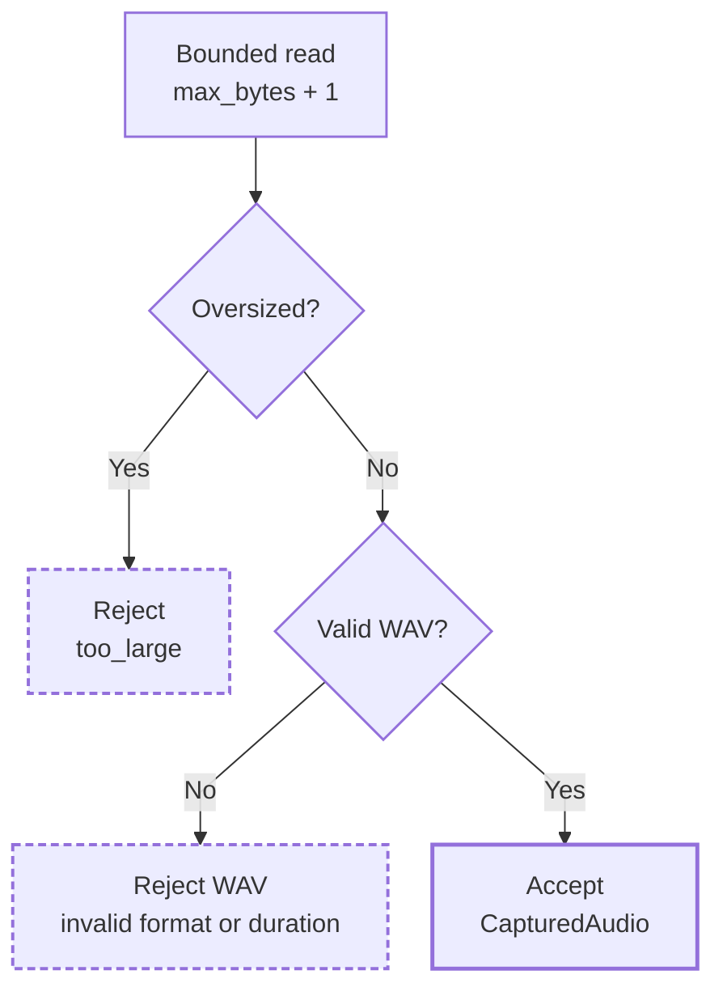
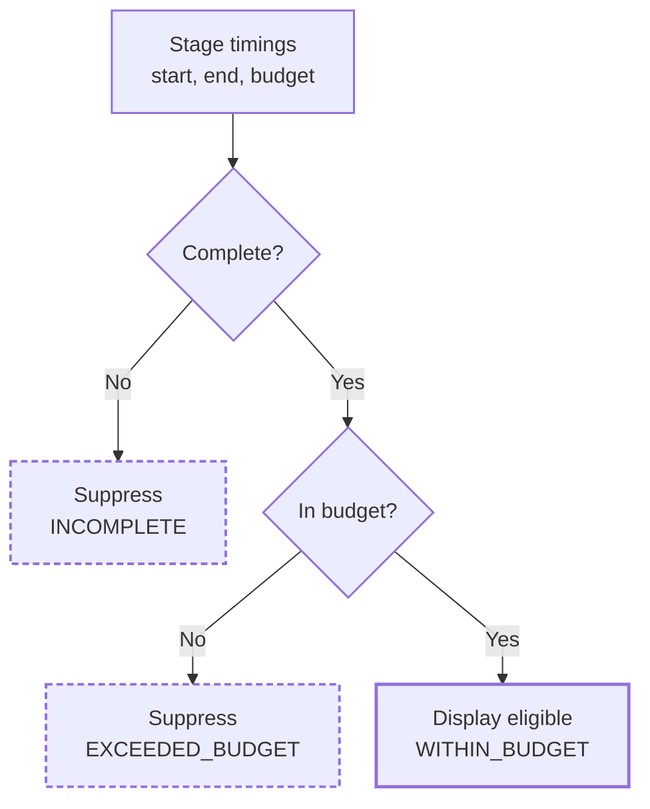

# Voice Pipeline Guard

A voice assistant that takes forever to answer has become a very expensive voicemail.

This Python module handles two unglamorous problems from realtime audio work: **don't accept malformed/oversized recordings**, and **don't present an answer if the timing evidence says it was late or never finished**.

## Two doors the audio has to get through

**Door one — capture.** `read_capture()` reads only up to the configured size limit (plus a probe byte), then checks WAV structure, format, and duration. The input is either acceptable or it isn't; we don't pretend a truncated file is fine.

**Door two — timing.** A `LatencyGate` records stage timing. Missing or invalid completion times produce `INCOMPLETE`; a stage over budget produces `EXCEEDED_BUDGET`; complete, in-budget evidence produces `WITHIN_BUDGET`.

Only the last case is eligible to display. "Probably fast enough" is not a timing measurement.

`UtteranceMetrics` intentionally contains timing/drop/display metadata — **no transcript text or audio bytes**.

## What gets through

Audio has to survive the first check before the rest of the pipeline should touch it.

A complete processing record still has to meet the time budget.

See [capture.py](src/audio_guard/capture.py), [latency.py](src/audio_guard/latency.py), [the tests](tests/), and [the latency contract](docs/latency-contract.md).

### A reality check

There is no microphone, telephony provider, transport, live transcript, or production latency claim in this repository. It's a runnable guard, not an end-to-end voice assistant. The audio is synthetic, which is convenient because it doesn't complain when the tests fail. [Verification](docs/verification.md) · [Provenance](PROVENANCE.md).
