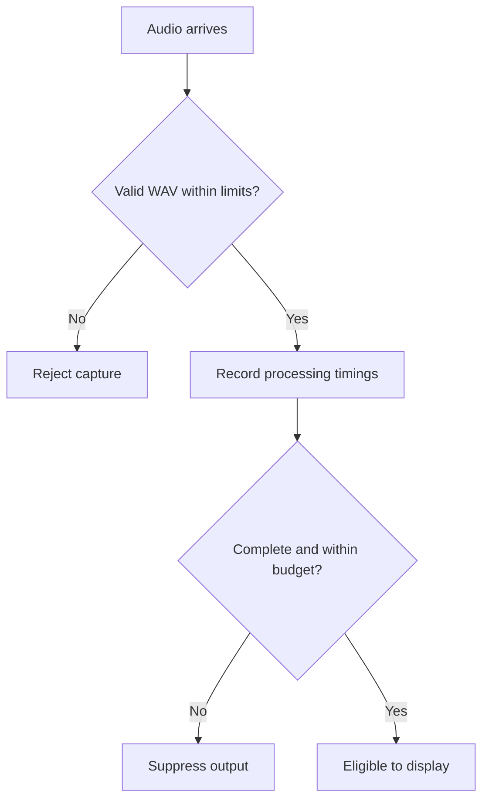

# Voice Pipeline Guard

Imagine the AI receptionist finally giving the perfect answer. The caller hung up six seconds ago. A perfect answer to an audience of zero.

I built this Python module around the less glamorous parts of a voice assistant: checking that the inputs are valid WAV audio, measuring how long processing took, and refusing to deliver an answer when its moment has passed. It can't make a slow model faster. It can stop me from pretending it was fast enough.

## Two doors between “hello” and an actual answer

First, reject invalid audio. Then check the timing. A beautiful response that missed its deadline does not get a consolation prize.

The capture reader takes at most the configured size limit **plus a probe byte**; it doesn't need to swallow a huge upload before noticing it's huge.

The timing gate makes three distinctions:

| Timing result | What it means | Display eligible? |
| --- | --- | --- |
| WITHIN_BUDGET | Complete evidence; stages in budget | Yes |
| EXCEEDED_BUDGET | A stage exceeded its configured limit | No |
| INCOMPLETE | Required completion timing missing or invalid | No |

That last case matters: a missing end timestamp is not proof that the answer was fast.

The [capture code](src/audio_guard/capture.py), [latency gate](src/audio_guard/latency.py), [tests](tests/), and [timing contract](docs/latency-contract.md) are the useful starting points. Metrics include timing/drop/display metadata but deliberately **not audio bytes or transcript text**.

## What it isn't

No microphone, phone number, speech-to-text service, telephony provider, or production latency benchmark is bundled here. The test audio is synthetic, and this is a **guard module**, not an end-to-end voice receptionist.

[Verification](docs/verification.md) · [provenance](PROVENANCE.md).
